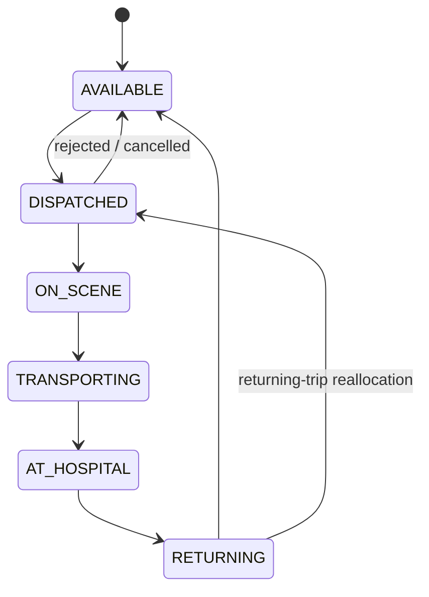

# SmartEMS architecture notes

## Trip state machine (backend/app/domain/trip_fsm.py)

## Main flow
Caller SOS -> `SOS_CREATED` -> dispatcher notified (WebSocket) -> matching recommends ambulance ->
dispatcher confirms -> driver accepts -> trip status updates -> hospital -> returning -> available.

## Layering rules
- `api/` only parses requests and calls `services/`.
- `services/` does DB / OSRM / event publishing.
- `algorithms/` and `domain/` are pure (no I/O) and are unit tested.
- `alembic/` is the single source of truth for the DB schema.

## Docs to fill in (deliverables)
requirements, API (see /docs on the running backend), test plan, test cases, test report, user guide, deployment guide.
